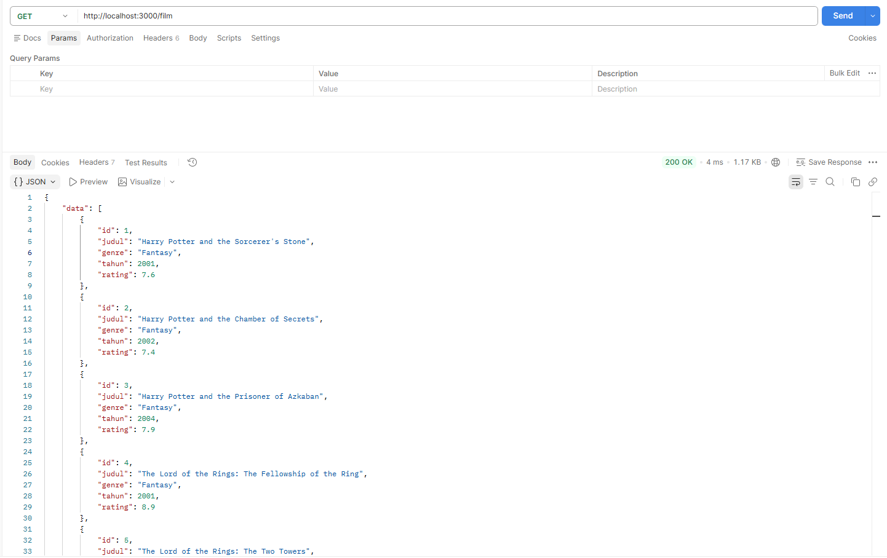
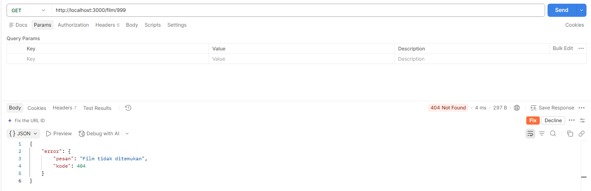
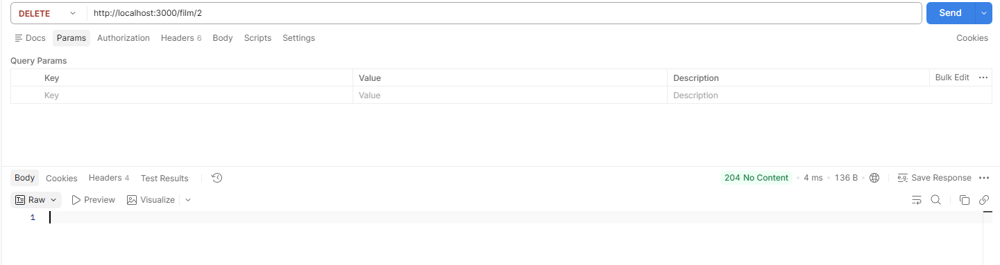
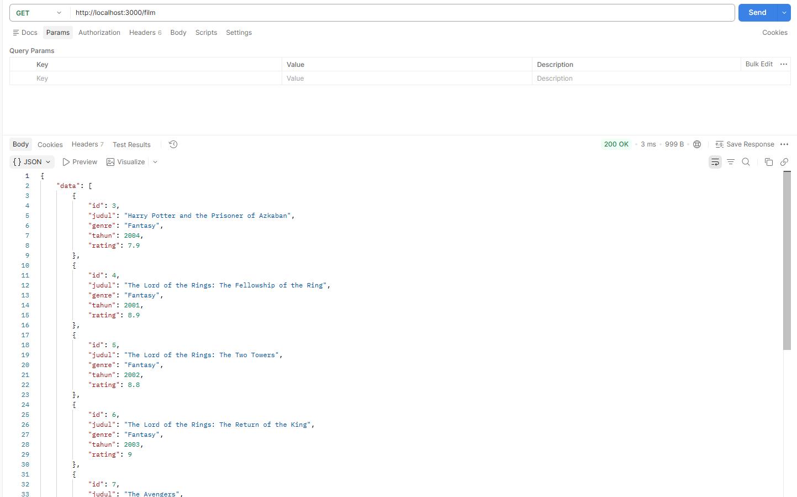

# Tugas 4 - REST API Dasar

## Identitas
- Nama: Ade Ratu Safitri
- NIM: F1D02410033
- Program Studi: Teknik Informatika

## Deskripsi
Proyek ini merupakan tugas REST API dasar menggunakan Express.js.
API yang dibuat menggunakan data koleksi film yang disimpan dalam
array of object di file terpisah.

## Teknologi
- Node.js
- Express.js
- JavaScript
- Postman

## Cara Menjalankan
1. Pastikan Node.js sudah terinstal.
2. Buka terminal pada folder proyek.
3. Jalankan perintah npm install.
4. Jalankan perintah npm run dev.
5. Buka http://localhost:3000.

## Daftar Endpoint

| Method | Endpoint | Fungsi | Status |
|---|---|---|---|
| GET | / | Menampilkan pesan sambutan | 200 |
| GET | /film | Menampilkan semua film | 200 |
| GET | /film/:id | Menampilkan detail film | 200 atau 404 |
| DELETE | /film/:id | Menghapus film | 204 atau 404 |

## Struktur Data
Setiap film memiliki atribut:
- id
- judul
- genre
- tahun
- rating

## Pengujian

1. GET /film menampilkan daftar film.
    
2. GET /film/1 menampilkan detail film.
    
3. GET /film/999 menghasilkan status 404.
    
4. DELETE /film/2 menghapus film.
    
5. GET /film setelah penghapusan menunjukkan perubahan data.
    

## Deklarasi Penggunaan AI

| Bagian | Alat AI | Tujuan Penggunaan | Verifikasi |
|---|---|---|---|
| Data film | ChatGPT | Membantu membuat contoh data | Memeriksa struktur data |
| REST API | ChatGPT | Membantu menyusun dan memahami kode | Menjalankan dan menguji endpoint |
| Penjelasan README | ChatGPT | Membantu menyusun README | Memeriksa kesesuaian dokumentasi |

## Kesimpulan
Melalui tugas ini, saya mempelajari dasar pembuatan REST API
menggunakan Express.js, pengambilan data berdasarkan ID,
penggunaan status HTTP, dan penanganan data yang tidak ditemukan.

## Kendala
Kendala selama pengerjaan tugas ini adalah menyesuaikan struktur folder dan konfigurasi proyek Node.js agar setiap file dapat terhubung dengan benar. Saya perlu memastikan lokasi file data film sesuai dengan jalur import pada index.js, serta menyesuaikan konfigurasi package.json agar server dapat dijalankan menggunakan perintah npm run dev.